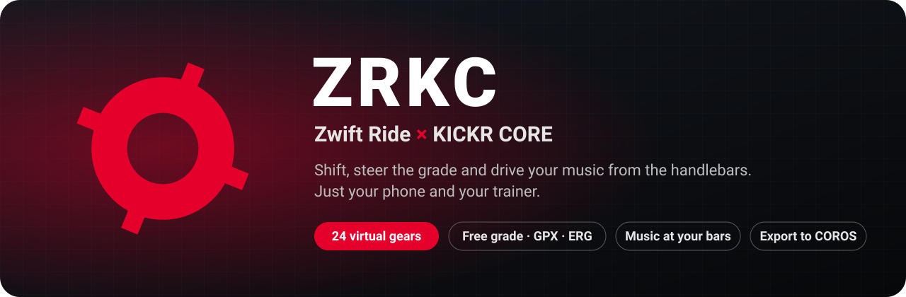
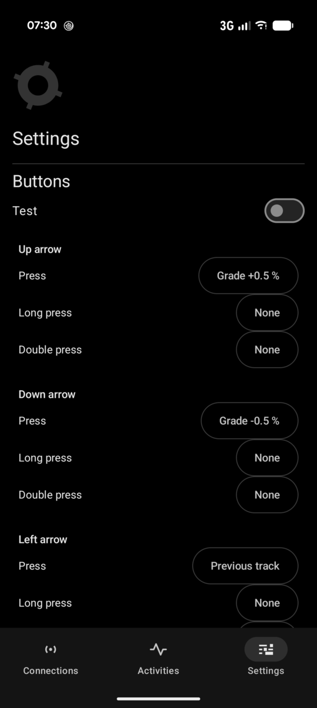
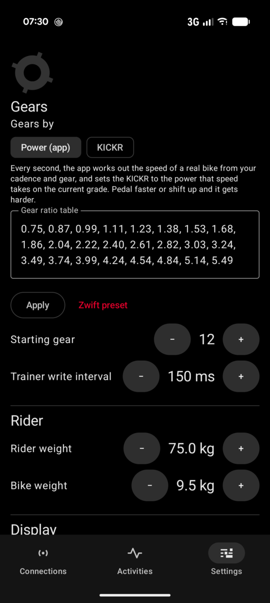
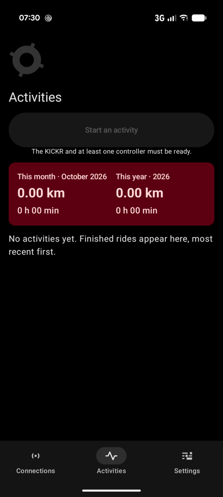
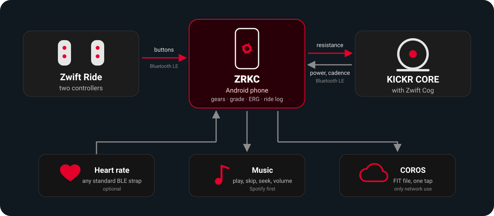

  

  
  
  
  

# ZRKC: ride your KICKR CORE from your Zwift Ride

**Your Zwift Ride controllers and your KICKR CORE, linked by your phone. No computer, no
tablet, no game.** Shift through 24 virtual gears, steer the grade or ride a GPX route,
hold an ERG target, skip tracks and turn up the volume without taking your hands off the
bars. Every ride is saved on the phone and can go to COROS in one tap.

  <a href="https://github.com/Engelnicolas/ZRKC-Zwift_Ride-Kickr_Core/releases/latest"><b>⬇ Download the APK</b></a>
  &nbsp;·&nbsp;
  <a href="#getting-started">Getting started</a>
  &nbsp;·&nbsp;
  <a href="docs/specification.md">Technical specification</a>

> **Independent project, not affiliated with Zwift Inc. or Wahoo Fitness.** The protocols
> were captured on the hardware for interoperability purposes. Use at your own risk.

## Why ZRKC

| | |
|---|---|
| ⚙️ **Real virtual shifting** | 24 gears out of the box, up to 60 in your own table. The app works out what a real bike would need at your cadence, gear and grade, every second. |
| ⛰️ **Three ways to ride** | Free grade, set from the controllers; a GPX route with its elevation profile; or ERG, holding a power target. |
| 🎵 **Music at your fingertips** | Play, pause, skip, seek and volume from the controllers, Spotify first. |
| 🎮 **Every button is yours** | 14 buttons and 2 paddles, each with press, long press and double press, with a live Test mode. |
| ❤️ **Heart rate** | Any standard Bluetooth heart rate strap, such as the COROS HRM. |
| 📈 **Ride history** | Duration, distance, power, cadence, climbing and gear changes, with your own comments and monthly and yearly totals. |
| ☁️ **Export to COROS** | The ride's FIT file lands in COROS Training Hub in one tap. |
| 🔒 **Private by design** | No account, no ads, no tracking. The network is used for nothing but the COROS export you ask for. |

## Screenshots

  
  &nbsp;
  
  &nbsp;
  

Button mapping · Gears and rider · Activities

## How it works

  

The phone is the head unit. It listens to both Ride controllers (the left pod relays the
right one), turns each press into an action, and drives the KICKR CORE in the Zwift
protocol it speaks natively, with standard FTMS as a fallback. By default the app works out
the gears itself (Settings › Gears › Gears by: Power): every second it takes the speed of a
real bike at your cadence and gear and sets the KICKR to the power that speed needs on the
current grade.

## Getting started

1. **Install.** On the phone (Android 12 or later), open the APK from the
   [latest release](https://github.com/Engelnicolas/ZRKC-Zwift_Ride-Kickr_Core/releases/latest)
   and allow installs from that source. [Obtainium](https://github.com/ImranR98/Obtainium)
   can watch the page and offer updates.
2. **Connect.** In Connections, allow Bluetooth and notifications, exclude the app from
   battery optimisation, tap Search, then Remember the Ride's left pod and the KICKR. Only
   remembered devices are joined afterwards.
3. **Ride.** Prepare the ride (or Start an activity in the Activities tab), choose the mode,
   Start. Everything is then controlled from the controllers; to finish, hold Finish while it
   counts down 2, 1.
4. **Review.** The summary takes a short comment and offers Export for COROS; every finished
   ride is listed in Activities, most recent first, to review, comment or delete.

> ⚠️ **Do not open the Zwift app while the Ride is on.** From firmware 1.3 onwards, Zwift
> locks the controllers. The app reads each controller's version and warns you.

### Default mapping

| Control | Action |
|---|---|
| Shift up / Shift down | Next / previous gear |
| Up / Down arrows | Grade ±0.5 % (or the ERG target) |
| Left / Right arrows | Previous / next track |
| A | Play / pause |
| Y / B | Volume |
| Z | Pause the ride |
| Right Power-up | Open Spotify |

Everything can be changed in Settings. The ride screen shows the track playing and its
progress; the track title needs notification access, which the app asks for from that screen.

### Export for COROS

Set up your account once in Settings › COROS account (region, e-mail, password). The password
is never stored: only its MD5, the form COROS signs in with, encrypted with a key from the
Android Keystore. After the upload the app follows the import until COROS confirms it, and it
never sends the same file twice, since COROS would make a duplicate activity. COROS has no public
upload API: this uses the private one behind Training Hub and may stop working without notice.

## Tested hardware

| Device | Version |
|---|---|
| Zwift Ride (two controllers) | firmware 1.2.0, hardware B.0 |
| KICKR CORE "85FF" with Zwift Cog | firmware 1.5.36 |
| Google Pixel 10 Pro | Android 17 (API 37); app minimum: Android 12 (API 31) |

The interface is in English only.

## For developers

### Building

Requirements: JDK 17 or newer, Android SDK with `platforms;android-37.0` and
`build-tools;36.0.0`, and a `local.properties` containing `sdk.dir=...` (not versioned).

    ./gradlew build              # tests, Android Lint, ktlint, detekt, debug and release APKs
    ./gradlew ktlintFormat       # reformats the code
    ./gradlew :app:installDebug  # on the connected phone (USB debugging)

Modules: `protocol/` (pure Kotlin logic, tested on the JVM against real frames), `ble/`
(Bluetooth links and device managers), `app/` (service, session, storage, screens).

### Signed release APK

The key stays outside the repository:

    keytool -genkeypair -keystore ~/.config/kick-zwift/release.jks -alias kickzwift \
            -keyalg RSA -keysize 4096 -validity 10000
    export KICKZWIFT_STORE_FILE=~/.config/kick-zwift/release.jks
    export KICKZWIFT_STORE_PASSWORD=... KICKZWIFT_KEY_ALIAS=kickzwift KICKZWIFT_KEY_PASSWORD=...
    ./gradlew :app:assembleRelease

Without these variables, the release APK is built unsigned. Back up the key: without it, no
update installs over a version already handed out.

### Releases for testers

Pushing a version tag builds the signed APK on GitHub and attaches
it to a release (`.github/workflows/release.yml`). The tag must match `versionName` in
`app/build.gradle.kts`; raise `versionCode` too, or the update won't install over the
previous one.

    git tag v1.2 && git push origin v1.2

The workflow reads four repository secrets: `KICKZWIFT_KEYSTORE_BASE64` (the key file,
`base64 -w0 release.jks`), `KICKZWIFT_STORE_PASSWORD`, `KICKZWIFT_KEY_ALIAS` and
`KICKZWIFT_KEY_PASSWORD`.

To install, testers open the APK from the
[Releases](https://github.com/Engelnicolas/ZRKC-Zwift_Ride-Kickr_Core/releases) page on the
phone (Android 12 or later) and allow installs from that source. A debug build, signed with
another key, must be uninstalled first. [Obtainium](https://github.com/ImranR98/Obtainium)
can watch the page and offer updates.

### Dependencies

Versions are pinned in `gradle/libs.versions.toml` and every artifact is
verified by its SHA-256 checksum (`gradle/verification-metadata.xml`). After a version bump,
run `./gradlew --write-verification-metadata sha256 --no-configuration-cache build`, then
build once with an empty `GRADLE_USER_HOME`, as the CI does: some metadata files are only
downloaded there. Review the diff before committing it.

### Tests and fuzzing

The `:protocol` tests replay frames captured on the Ride and the
KICKR (`docs/captures/`, `docs/journaux/`). Jazzer targets live in `protocol/src/fuzz` and
run nightly in CI (`.github/workflows/fuzz.yml`).

## License

Copyright (C) 2026 Nicolas Engel

This program is free software: you can redistribute it and/or modify it under the terms of
the GNU Affero General Public License as published by the Free Software Foundation, either
version 3 of the License, or (at your option) any later version.

This program is distributed in the hope that it will be useful, but WITHOUT ANY WARRANTY;
without even the implied warranty of MERCHANTABILITY or FITNESS FOR A PARTICULAR PURPOSE.
See the [LICENSE](LICENSE) file for details.
